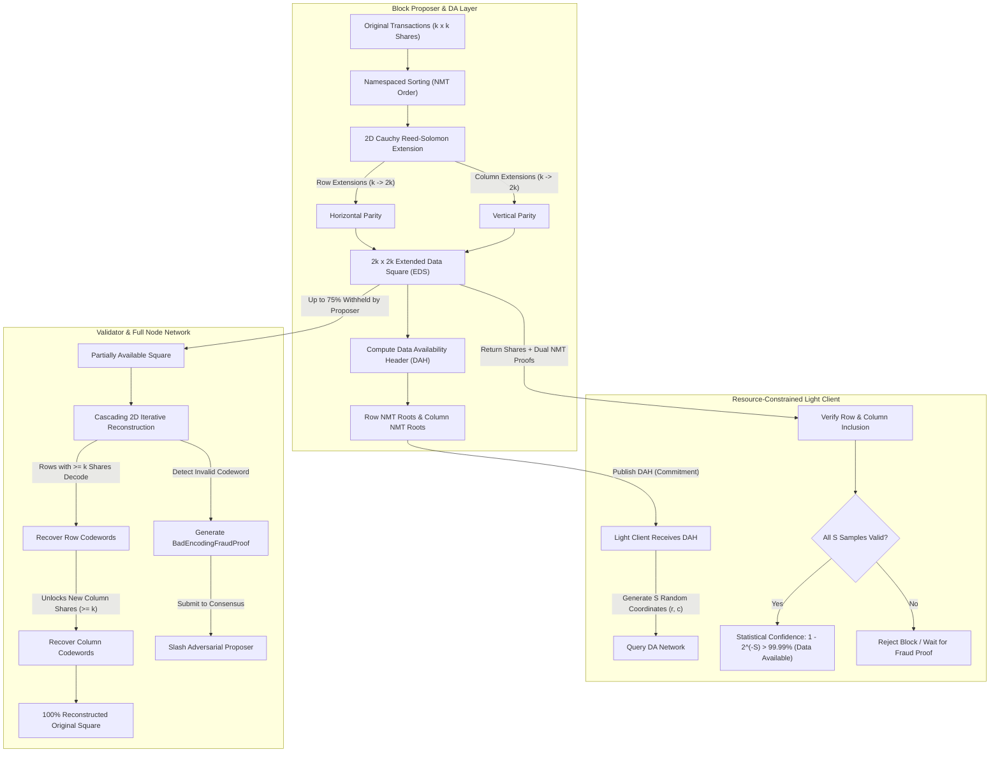

# AuraDA

[](https://github.com/ZengLLQ/aura-da/actions)
[](https://goreportcard.com/report/github.com/ZengLLQ/aura-da)
[](LICENSE)
[]()

**AuraDA** is a high-performance, modular blockchain Data Availability (DA) engine in pure Go. It implements 2D Reed-Solomon Erasure Coding over Galois Field $GF(2^8)$, Celestia-style Namespaced Merkle Trees (NMT) with inclusion & absence proofs, 2D Extended Data Squares (EDS), Data Availability Sampling (DAS) for lightweight nodes, cascading iterative square reconstruction under adversarial withholding, and compact Bad Encoding Fraud Proofs.

---

## Architectural Workflow



---

## Mathematical Formulations

### 1. Galois Field $GF(2^8)$ Arithmetic

The finite field $GF(2^8)$ is constructed using the standard primitive irreducible polynomial:

$$p(x) = x^8 + x^4 + x^3 + x^2 + 1 \quad (\text{0x11D} = 285)$$

- **Addition & Subtraction:** Bitwise XOR: $a \oplus b$.
- **Multiplication:** Precomputed logarithm and antilogarithm lookup tables with generator $\alpha = 2$:
  $$a \times b = \exp\left( (\log(a) + \log(b)) \bmod 255 \right)$$
- **Multiplicative Inverse:** $a^{-1} = \exp\left( (255 - \log(a)) \bmod 255 \right)$ for all $a \ne 0$.

### 2. Systematic Cauchy Reed-Solomon Erasure Coding

To guarantee that *every* square submatrix is invertible without singular edge cases, AuraDA utilizes a Cauchy generator matrix $G$:

$$G = \begin{bmatrix} I_k \\ A \end{bmatrix} \quad \text{where } A_{i, j} = \frac{1}{X_i \oplus Y_j}$$

Where $X = \{k, k+1, \dots, 2k-1\}$ and $Y = \{0, 1, \dots, k-1\}$ are disjoint sets in $GF(2^8)$.

- **Systematic Property:** Codeword $C = G \cdot D$ preserves original message shards in the first $k$ positions:
  $$C_i = D_i \quad \forall i \in [0, k-1]$$
- **Erasure Recovery:** From ANY $k$ out of $2k$ available shards $C_{\text{avail}}$, original message $D$ is recovered by inverting the selected $k \times k$ submatrix $G_{\text{avail}}$:
  $$D = \left( G_{\text{avail}} \right)^{-1} \cdot C_{\text{avail}}$$

### 3. Namespaced Merkle Tree (NMT)

Data shares are grouped by an 8-byte namespace identifier. Leaves are ordered such that $N_1 \le N_2 \le \dots \le N_n$.

$$\text{LeafHash}(N, D) = \text{SHA256}(0x00 \parallel N \parallel N \parallel D)$$

$$\text{NodeHash}(L, R) = \text{SHA256}(0x01 \parallel \min(L.\text{min}, R.\text{min}) \parallel \max(L.\text{max}, R.\text{max}) \parallel L.\text{Digest} \parallel R.\text{Digest})$$

- **Proof of Absence:** If a queried namespace $N_{\text{target}}$ does not exist, an adjacent leaf whose namespace interval spans across $N_{\text{target}}$ proves non-existence with standard $O(\log n)$ Merkle paths.

### 4. Data Availability Sampling (DAS) Confidence

If an adversarial proposer withholds $>50\%$ of the square to hide invalid state transitions, each random coordinate sample $(r, c)$ has $\ge 50\%$ probability of falling on a withheld share.

After $S$ successful random samples, the probability that the block is unavailable is bounded by:

$$P(\text{unavailable}) \le \left(\frac{1}{2}\right)^S \implies \text{Confidence} = 1 - \left(\frac{1}{2}\right)^S$$

| Sample Count ($S$) | Availability Confidence | Error Margin |
| :---: | :---: | :---: |
| **8** | 99.609375% | $< 4 \times 10^{-3}$ |
| **16** | **99.998474%** | $< 1.6 \times 10^{-5}$ |
| **20** | **99.999905%** | $< 1 \times 10^{-6}$ |
| **30** | **99.999999%** | $< 1 \times 10^{-9}$ |

---

## Package Architecture

| Package | Path | Responsibility |
| :--- | :--- | :--- |
| **`galois`** | `pkg/galois/` | $GF(2^8)$ finite field arithmetic, log/exp tables, inversion, and SIMD-friendly vector operations. |
| **`reedsolomon`** | `pkg/reedsolomon/` | Cauchy generator matrices, Gaussian elimination inversion, systematic encoding, and erasure recovery. |
| **`nmt`** | `pkg/nmt/` | Namespaced Merkle Trees, namespace range bounds, inclusion proofs, and proofs of absence. |
| **`eds`** | `pkg/eds/` | 2D Extended Data Square ($2k \times 2k$) construction and Data Availability Header (DAH) computation. |
| **`das`** | `pkg/das/` | Light client random sampling, dual NMT proof verification, and statistical confidence calculation. |
| **`reconstruct`** | `pkg/reconstruct/` | Cascading 2D iterative square reconstruction algorithm under adversarial withholding. |
| **`fraud`** | `pkg/fraud/` | Compact Bad Encoding Fraud Proof generation and mathematical verification against DAH roots. |
| **`cli`** | `cmd/aurada/` | Production CLI utility supporting `encode`, `sample`, `reconstruct`, and `fraud` commands. |

---

## Verification & Testing

AuraDA includes comprehensive automated unit and integration tests with Go's race detector:

```bash
# Run all test suites with race detection
go test -v -race ./...
```

### Test Suite Summary

- `pkg/galois`: Multiplicative identity, inverses ($\forall a \in [1, 255]$), commutativity, and distributivity axioms.
- `pkg/reedsolomon`: Systematic invariant preservation, parity verification, and arbitrary erasure recovery across $k \in \{2, 4, 8, 16\}$.
- `pkg/nmt`: Root computation, out-of-order rejection, multi-leaf namespaced inclusion, and absence verification.
- `pkg/eds`: 2D Extended Data Square generation, systematic $Q_1$ preservation, and DAH calculation.
- `pkg/das`: Light client sampling of 16 coordinates, dual row/col proof validation, and tamper detection.
- `pkg/reconstruct`: Cascading 2D iterative recovery with 50% shares withheld.
- `pkg/fraud`: Bad Encoding Fraud Proof generation on corrupted parity, verification, and rejection on valid data.

---

## CLI Usage

### Build CLI

```bash
go build -o aurada cmd/aurada/main.go
```

### Commands

```bash
# 1. Generate 2D Extended Data Square (4x4 original -> 8x8 EDS) and DAH
./aurada encode -k 4

# 2. Simulate light client Data Availability Sampling with 16 random coordinates
./aurada sample -k 4 -samples 16

# 3. Simulate cascading reconstruction with 50% shares withheld
./aurada reconstruct -k 4

# 4. Generate and verify a Bad Encoding Fraud Proof on a malicious block
./aurada fraud
```

---

## License

This project is licensed under the [MIT License](LICENSE).
